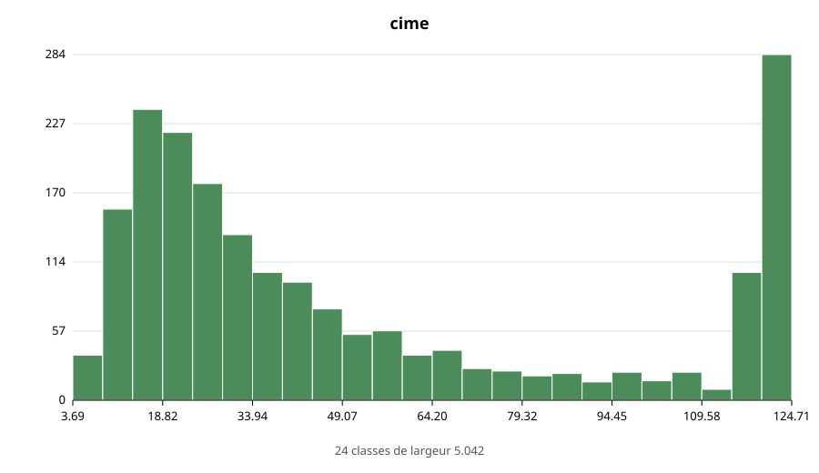
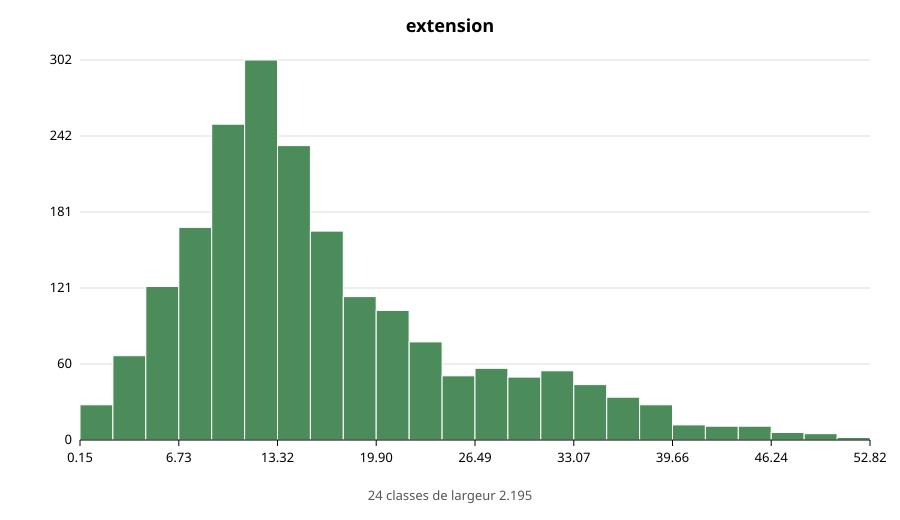
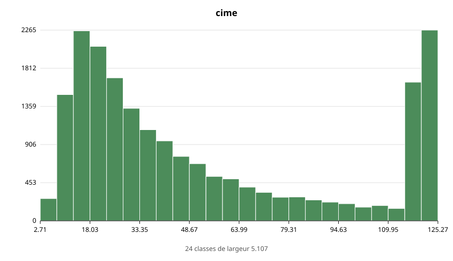
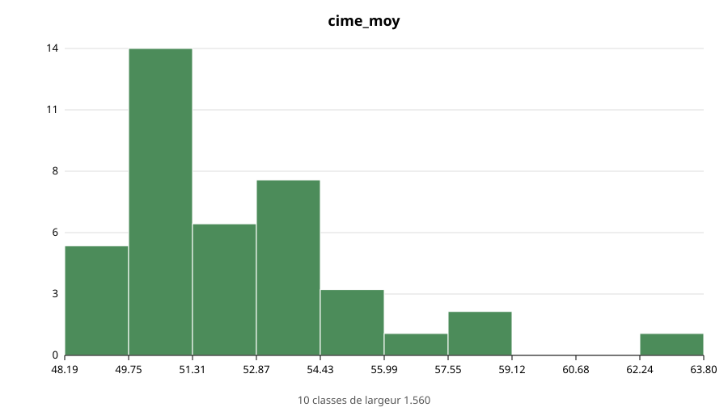
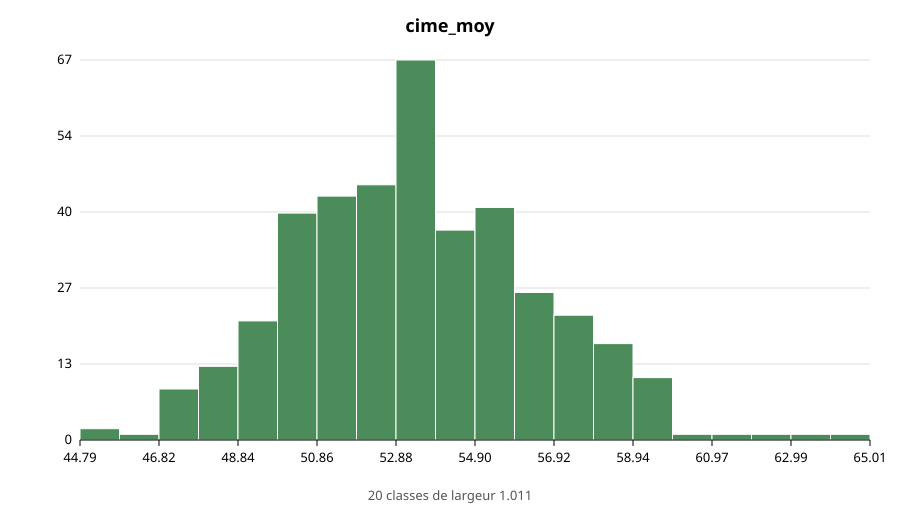
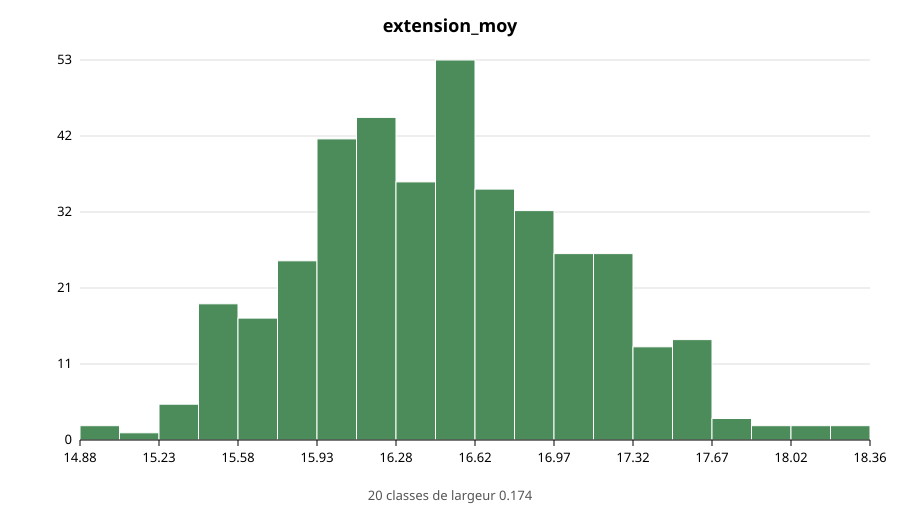

# TI301 — Partie 3 : analyse des simulations de forêts

**Efrei Paris — Structures de données et algorithmes**  
**Auteurs : Victor OKOU et Fabio Devine**

## 1. Conditions de simulation

Deux campagnes ont été exécutées avec les mêmes paramètres : 50 arbres par forêt (`K = 50`), un espacement `E = 3`, une absorption de lumière `A = 0,25`, 120 saisons et une graine initiale de 101. Les troncs ont été plantés à des hauteurs aléatoires (`identique = 0`). Chaque forêt utilise une graine différente.

| Campagne | Nombre de forêts | Nombre d'arbres | Temps de calcul |
|---|---:|---:|---:|
| C1 | 40 | 2 000 | 4,893 s |
| C2 | 400 | 20 000 | 45,775 s |

Le temps de calcul a été multiplié par environ 9,36 entre C1 et C2, pour un nombre de forêts multiplié par 10.

La vérification des données confirme que les 2 000 arbres de C1 correspondent exactement aux 2 000 premiers arbres de C2. Les moyennes par forêt sont cohérentes avec les mesures des arbres, à l'arrondi du CSV près.

## 2. Résultats statistiques

Les statistiques suivantes ont été recalculées à partir des fichiers CSV produits par nos simulations. L'écart-type est calculé avec le diviseur `n`, et l'asymétrie comme le moment centré d'ordre 3 divisé par le cube de l'écart-type, conformément au code statistique fourni. Les quartiles correspondent aux observations de rang `ceil(n/4)` et `ceil(3n/4)`.

| Données étudiées | Effectif | Moyenne | Écart-type | Médiane | Asymétrie |
|---|---:|---:|---:|---:|---:|
| C1 — Cime des arbres | 2 000 | 52,3644 | 39,8709 | 35,3910 | 0,7765 |
| C1 — Extension des arbres | 2 000 | 16,3505 | 9,4872 | 13,8370 | 1,0683 |
| C2 — Cime des arbres | 20 000 | 53,3947 | 39,9240 | 37,2930 | 0,7113 |
| C1 — Cime moyenne par forêt | 40 | 52,3644 | 2,9141 | 51,5453 | 1,6758 |
| C2 — Cime moyenne par forêt | 400 | 53,3947 | 3,0653 | 53,2475 | 0,2931 |
| C2 — Extension moyenne par forêt | 400 | 16,4933 | 0,6047 | 16,4648 | 0,2409 |

### Minimums, maximums et quartiles

| Données étudiées | Minimum | Q1 | Q3 | Maximum |
|---|---:|---:|---:|---:|
| C1 — Cime des arbres | 3,6910 | 20,3120 | 83,4250 | 124,7050 |
| C1 — Extension des arbres | 0,1490 | 9,9210 | 20,7770 | 52,8240 |
| C2 — Cime des arbres | 2,7100 | 20,4470 | 85,8370 | 125,2700 |
| C1 — Cime moyenne par forêt | 48,1917 | 50,1310 | 53,6816 | 63,7965 |
| C2 — Cime moyenne par forêt | 44,7942 | 51,2240 | 55,2791 | 65,0087 |
| C2 — Extension moyenne par forêt | 14,8839 | 16,0527 | 16,9055 | 18,3633 |

### Comparaison avec les références du sujet

Les résultats sont proches des références du professeur, mais ils ne sont pas strictement identiques. Les valeurs ci-dessous montrent les principaux écarts, à investiguer si une correspondance numérique exacte est exigée.

| Indicateur | Notre simulation | Référence du sujet |
|---|---:|---:|
| C1 — Moyenne des cimes des arbres | 52,3644 | 52,3552 |
| C1 — Moyenne des extensions des arbres | 16,3505 | 16,3600 |
| C2 — Moyenne des cimes moyennes | 53,3947 | 53,3789 |
| C2 — Moyenne des extensions moyennes | 16,4933 | 16,4996 |
| C2 — Asymétrie des cimes moyennes | 0,2931 | 0,3098 |
| C2 — Asymétrie des extensions moyennes | 0,2409 | 0,3126 |

Les réponses ci-dessous s'appuient sur **nos données réelles**, et non sur les chiffres de référence.

## 3. Réponses aux questions du sujet

### Question 1 — Distribution des cimes des 2 000 arbres (C1)

L'histogramme présente **deux bosses principales**. La première correspond aux arbres de faible cime, avec un maximum dans la classe **[13,78 ; 18,82[** (239 arbres). La seconde se situe tout à droite, dans la classe **[119,66 ; 124,71]** (284 arbres). Elles représentent respectivement le groupe des arbres restés relativement petits et celui des arbres ayant atteint une cime élevée, proche de la hauteur maximale observée. Entre ces deux groupes, les effectifs sont beaucoup plus faibles.

### Question 2 — Distribution des extensions et comparaison des asymétries (C1)

L'histogramme des extensions présente **une seule bosse principale**, autour de **11 à 13 unités**. Les effectifs diminuent ensuite progressivement vers les grandes extensions : la distribution possède une longue queue à droite. Contrairement aux cimes, on n'observe pas une seconde concentration comparable près du maximum.

L'extension possède une asymétrie positive de **1,0683**, supérieure à celle des cimes (**0,7765**). **L'extension est donc la mesure la plus asymétrique**. Les valeurs exceptionnellement grandes se trouvent **à droite** de l'histogramme.

### Question 3 — Moyenne, médiane et caractère représentatif de la cime (C1)

La moyenne des cimes vaut **52,3644**, alors que la médiane vaut **35,3910** : la moyenne est nettement plus élevée.

La moyenne se situe dans la classe **[49,07 ; 54,11[**, qui contient **54 arbres sur 2 000**, soit **2,7 %** des valeurs. Elle se trouve **entre les deux bosses principales**, dans une zone relativement peu représentée. La médiane se trouve plus près du groupe des petits arbres.

Ainsi, la moyenne décrit le niveau général des cimes, mais elle n'est **pas une cime typique** d'un arbre tiré au hasard dans cette distribution. Les deux groupes d'arbres sont mieux visibles sur l'histogramme que dans la seule valeur moyenne.

### Question 4 — Distribution des cimes des 20 000 arbres (C2)

Avec **20 000 arbres**, la distribution conserve **les deux mêmes bosses** que dans C1. La première se situe vers **13 à 18 unités** et la seconde vers **120 à 125 unités**. Les classes les plus remplies contiennent respectivement **2 256** et **2 265** arbres.

L'histogramme est plus régulier, car il contient dix fois plus d'observations, mais sa structure d'ensemble ne change pas. La moyenne passe de **52,3644** (C1) à **53,3947** (C2). L'asymétrie reste positive : **0,7765** (C1), puis **0,7113** (C2).

### Question 5 — Distribution des cimes moyennes par forêt (C1 et C2)

**C1 — 40 forêts, 10 classes**

Les 40 moyennes présentent une concentration principale autour de **50 à 54 unités**, mais la forme est irrégulière. Une forêt possède une moyenne particulièrement élevée, **63,7965**, ce qui allonge la queue vers la droite. L'asymétrie est **1,6758**.

**C2 — 400 forêts, 20 classes**

Avec 400 forêts, l'histogramme possède **une seule bosse dominante**, centrée autour de **53 à 54 unités**. Il est nettement plus proche d'une courbe en cloche, même s'il n'est pas parfaitement symétrique. Son asymétrie vaut **0,2931**, contre **0,7113** pour les cimes individuelles de C2.

La dispersion est également beaucoup plus faible pour les moyennes par forêt : leur écart-type est **3,0653**, contre **39,9240** pour les cimes individuelles. Cette observation est cohérente avec la forme générale annoncée par le théorème central limite, sans constituer à elle seule une démonstration de ce théorème.

### Question 6 — Distribution des extensions moyennes par forêt (C2)

Les extensions moyennes présentent également **une seule bosse principale**, autour de **16,45 à 16,62 unités**. La distribution est assez resserrée et approximativement symétrique, avec une légère queue vers les grandes valeurs.

L'asymétrie des extensions moyennes vaut **0,2409**, contre **1,0683** pour les extensions des arbres pris individuellement dans C1 (**1,0402** si l'on prend les 20 000 arbres de C2). L'écart-type des extensions moyennes est **0,6047**, contre **9,4766** pour les extensions individuelles de C2.

L'histogramme des extensions individuelles est nettement étiré à droite, tandis que celui des extensions moyennes se rapproche d'une forme en cloche.

### Question 7 — Les 40 forêts de C1 suffisent-elles ? Comparaison générale

**Non, pas pour reconnaître clairement la forme de la distribution des moyennes de cimes.** Avec 40 valeurs seulement, l'histogramme de C1 est assez irrégulier et sensible aux valeurs extrêmes. L'asymétrie de **1,6758** peut donner l'impression d'une distribution fortement déséquilibrée. Avec les 400 moyennes de C2, la forme en cloche devient bien plus nette et l'asymétrie baisse à **0,2931**.

Les cimes et les extensions individuelles ont des distributions différentes : **deux bosses** pour les cimes, contre **une bosse avec une longue queue à droite** pour les extensions. En revanche, leurs **moyennes par forêt** présentent toutes deux une distribution plus concentrée, avec une seule bosse principale et une asymétrie faible dans C2 (**0,2931** pour les cimes moyennes et **0,2409** pour les extensions moyennes).

La différence entre les deux mesures est donc beaucoup moins visible dans la forme de leurs distributions de moyennes que dans celle de leurs distributions individuelles.

## 4. Pourquoi la moyenne de `cime_moy` est-elle égale à celle de `cime` ?

Chaque forêt contient exactement 50 arbres. Si l'on note `cime(r,k)` la cime de l'arbre `k` dans la forêt `r`, la moyenne des cimes moyennes des 40 forêts vaut :

\[
\frac{1}{40}\sum_{r=1}^{40}\left(\frac{1}{50}\sum_{k=1}^{50}\operatorname{cime}(r,k)\right)
=\frac{1}{2000}\sum_{r=1}^{40}\sum_{k=1}^{50}\operatorname{cime}(r,k).
\]

Il s'agit exactement de la moyenne des 2 000 arbres réunis. Dans nos données, les deux valent **52,3644**, à l'arrondi des fichiers CSV près. Cette égalité repose sur le fait que **toutes les forêts ont le même nombre d'arbres**.

## 5. Conclusion

Les campagnes confirment que les cimes et les extensions des arbres individuels ne sont pas réparties de la même façon. Les cimes se regroupent principalement autour de deux niveaux, tandis que les extensions forment une distribution à une seule bosse et plus asymétrique.

Lorsqu'on étudie les moyennes de 50 arbres par forêt, les distributions sont beaucoup plus concentrées. L'analyse des 400 forêts de C2 montre des histogrammes proches d'une forme en cloche pour les deux mesures. Les 40 forêts de C1 permettent d'observer les premières tendances, mais elles ne suffisent pas à en apprécier clairement la forme.

**Remarque sur la reproductibilité :** les campagnes C1 et C2 sont cohérentes entre elles, mais quelques statistiques diffèrent légèrement des références numériques du sujet. Cela doit être signalé si une validation exacte est attendue.

## Source

Sujet officiel : https://nicolas-flasque-efrei.github.io/TI-301/projet/partie3/EN/

